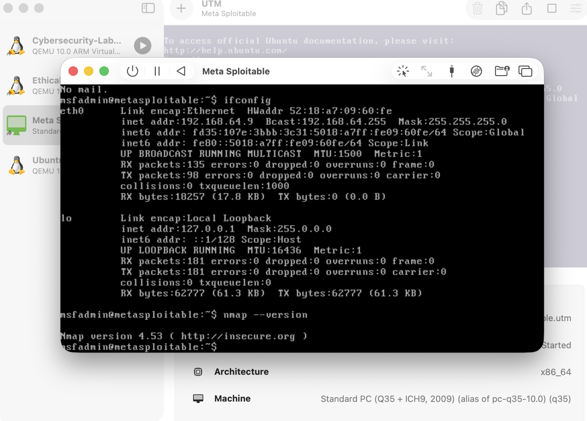
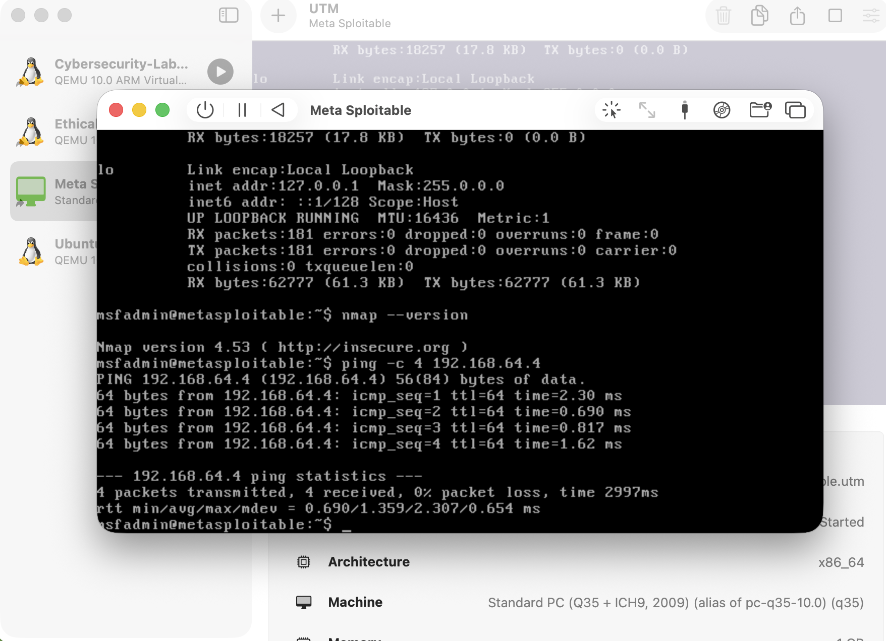
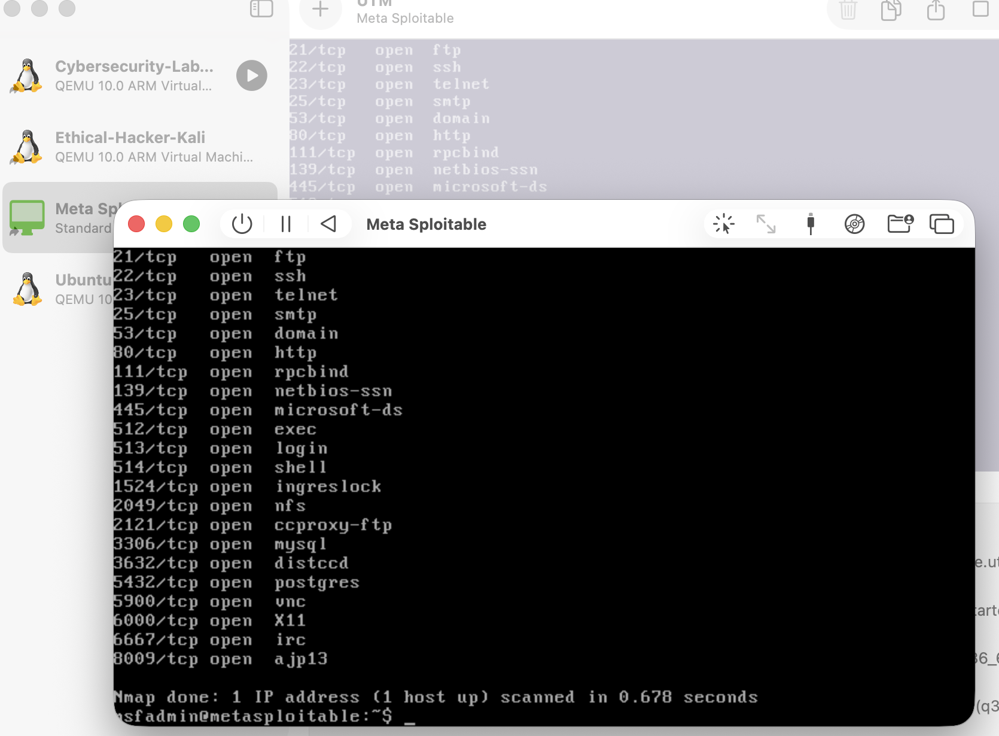
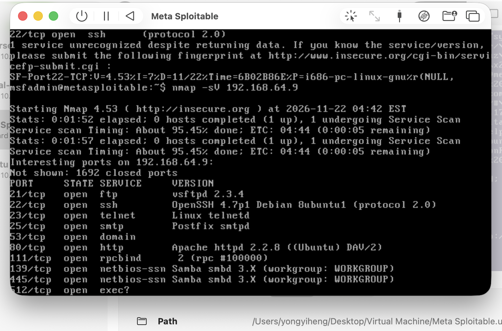

# Project 2: Nmap Service Scan

## 1. Project Objective

The objective of this project is to understand network reconnaissance and service enumeration using Nmap in an authorised virtual lab environment.

This project focuses on identifying open ports, detecting running network services, and examining service versions on a target machine. It also aims to develop practical knowledge of network scanning and the potential security risks associated with exposed services.

## 2. Environment and Tools

- **Attacker Machine:** Kali Linux
- **Target Machine:** Metasploitable 2
- **Scanning Tool:** Nmap
- **Virtualisation Platform:** UTM
- **Network Environment:** UTM Shared Network

## 3. Methodology

The following steps were performed to conduct the Nmap service scan:

1. Started the Kali Linux virtual machine.
2. Started the Metasploitable 2 virtual machine.
3. Identified the target machine's IP address using the `ifconfig` command.
4. Verified network connectivity between Kali Linux and Metasploitable 2 using the `ping` command.
5. Checked the installed Nmap version in Kali Linux.
6. Performed a basic network scan using Nmap to identify open ports and associated services.
7. Used Nmap service version detection to identify the software versions of discovered services.
8. Saved the scan results in a text file for further analysis.
9. Examined the scan results to understand the potential security implications of exposed services.

## 4. Results and Evidence

The following screenshots and supporting files demonstrate the Nmap scanning process and its results.

### 4.1 Nmap Version Verification

The installed Nmap version was checked using the `nmap --version` command to confirm that the scanning tool was available in Kali Linux.

### 4.2 Network Connectivity Verification

A ping test was performed from Metasploitable 2 to verify communication with the Kali Linux target machine before conducting the scan.

### 4.3 Basic Nmap Scan

A basic Nmap scan was performed to identify open ports and their associated services on the target machine.

### 4.4 Service Version Detection

The `-sV` option was used to detect the versions of services running on the discovered open ports. This provided additional information about the software operating on the target machine.

### 4.5 Saved Nmap Scan Results

The scan results were saved in normal text format using the `-oN` option. The output file provides a record of the discovered ports, services, and detected versions for further analysis.

[View Nmap Service Scan Results](evidence/nmap-service-scan.txt)

## 5. Findings and Analysis

The Nmap scan was used to identify open ports and running network services on the Metasploitable 2 target machine.

The service version detection process provided additional information about the software associated with the discovered open ports.

The following table summarises the findings obtained from the Nmap scan:

| Port | Service | Detected Version | Security Implications |
|---|---|---|---|
| 21/tcp | FTP | vsftpd 2.3.4 | ELogin credentials and transferred files may be intercepted because traditional FTP does not encrypt communication by default. |
| 22/tcp | SSH | OpenSSH 4.7p1 | The outdated software version may contain known security vulnerabilities that could be exploited if the system is not properly secured. |
| 23/tcp | Telnet | Linux telnetd | Login credentials and transmitted data may be captured by attackers because Telnet sends information without encryption by default. |

The results demonstrate how Nmap can help identify exposed network services and provide useful information for security assessment. Identifying these services is an important step in understanding the potential attack surface of a system.

## 6. Challenges and Improvements

One of the challenges encountered during this project was establishing network connectivity between Kali Linux and Metasploitable 2. The virtual machines initially experienced communication issues because their network configurations needed to be checked and aligned.

This was addressed by configuring both virtual machines to use the UTM Shared Network, allowing them to communicate within the virtual lab environment.

Another challenge was understanding the Nmap scan results, particularly the differences between open ports, service names, and detected software versions.

Possible improvements include:

- Exploring additional Nmap scanning options to obtain more detailed information.
- Researching detected service versions to identify known vulnerabilities using reliable security references.
- Organising scan results and evidence more systematically for easier analysis.
- Comparing scan results from different scanning techniques to understand their differences.

## 7. Security Considerations

All scanning activities were conducted within an authorised and controlled virtual lab environment using Kali Linux and Metasploitable 2.

Metasploitable 2 is an intentionally vulnerable virtual machine used solely for educational and cybersecurity testing purposes.

The target virtual machine was configured within a private virtual network to avoid exposing its vulnerable services to external networks.

All scanning activities were restricted to the user's own virtual lab environment.
