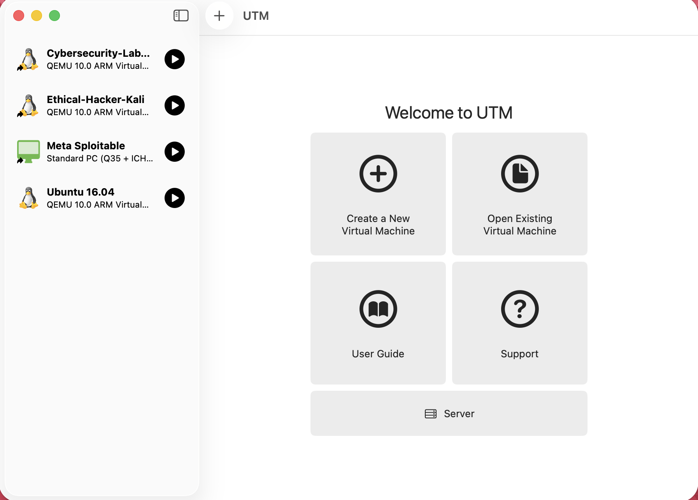
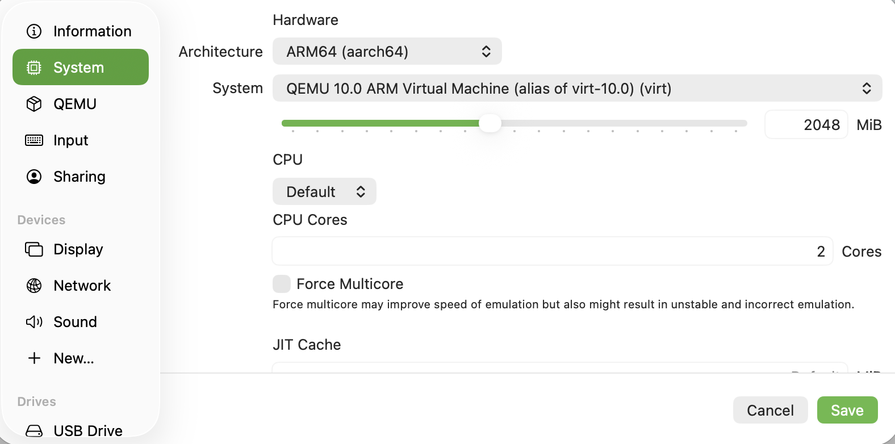
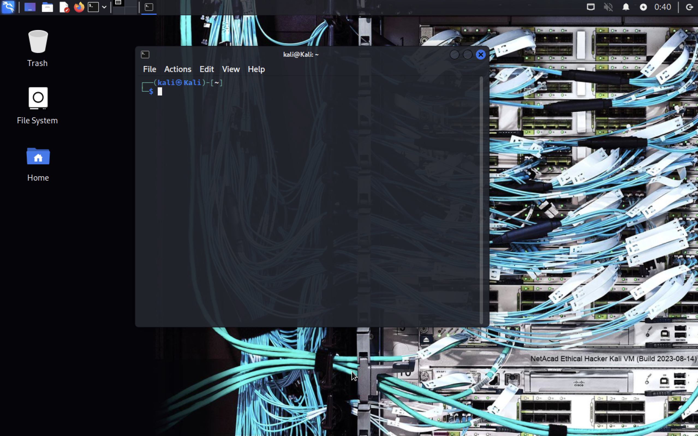
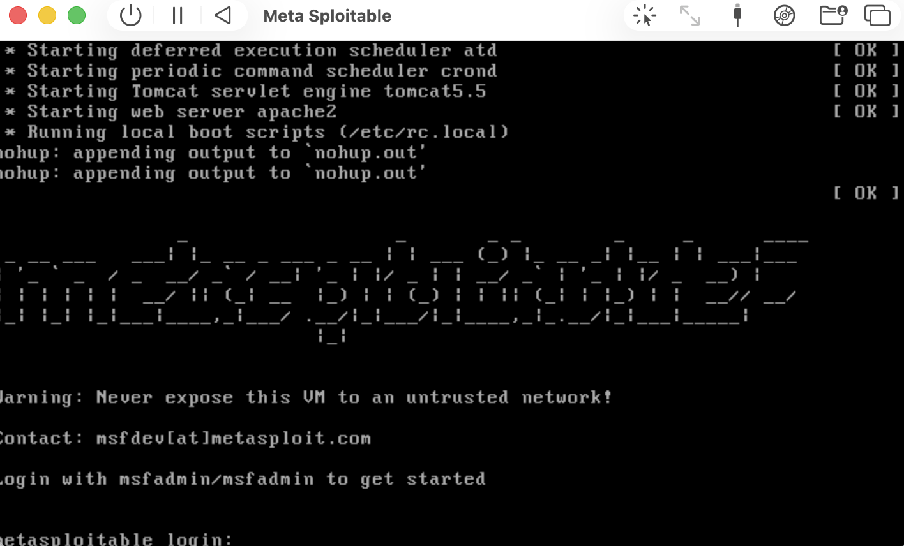
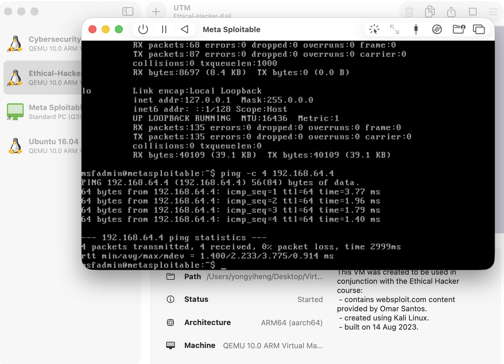
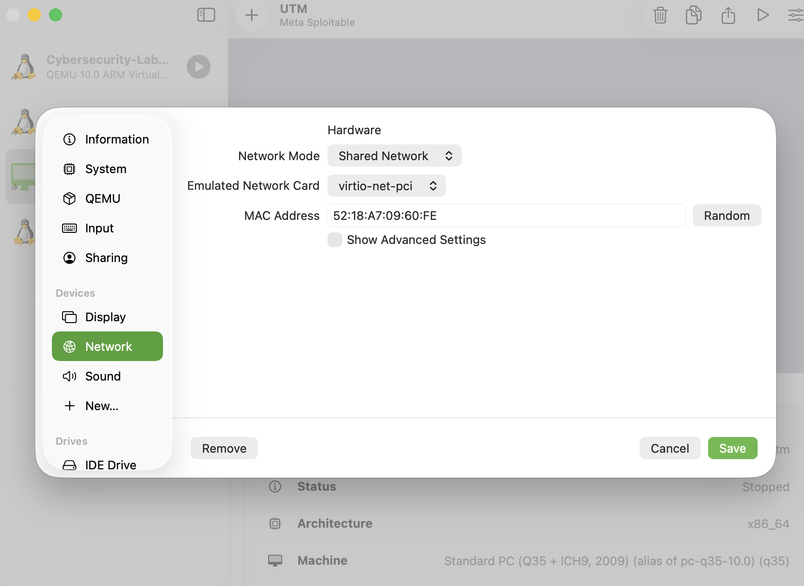

# Project 1: Virtual Lab Setup

## 1. Project Objective

The objective of this project is to establish a cybersecurity
virtual lab environment for practising cybersecurity concepts
and penetration-testing techniques in a controlled environment.

## 2. Environment and Tools

- Host Operating System: macOS
- Virtualisation Software: UTM
- Attacker Machine: Kali Linux
- Target Machine: Metasploitable 2

## 3. Methodology

1. Install and configure UTM.
2. Set up the Kali Linux virtual machine.
3. Set up the Metasploitable 2 virtual machine.
4. Configure the virtual network.
5. Verify communication between the virtual machines.

## 4. Results and Evidence

### 4.1 UTM Virtual Machine Configuration

The following screenshot shows the virtual machines
configured in UTM for the cybersecurity laboratory.

### 4.2 Virtual Machine Configuration

This screenshot shows the configuration of the
virtual machines, including their allocated resources.

### 4.3 Kali Linux Successfully Booted

The following screenshot demonstrates that the
Kali Linux virtual machine was successfully started.

### 4.4 Metasploitable 2 Successfully Booted

This screenshot demonstrates that the
Metasploitable 2 virtual machine was successfully started.

### 4.5 Virtual Network Connectivity Test

The following screenshot demonstrates the
network connectivity test between the virtual machines.

### 4.6 Network Configuration

This screenshot shows the network configuration
used for the virtual laboratory.

## 5. Challenges and Improvements

During the virtual lab setup, I encountered several
challenges:

1. **Virtualisation Software Compatibility**

   Initially, I attempted to use Oracle VM VirtualBox
   to run Metasploitable 2. However, I encountered
   difficulties getting the virtual machine to run
   successfully. Therefore, I decided to switch to UTM,
   which allowed me to continue setting up my lab.

2. **Virtual Machine Configuration**

   Configuring both virtual machines required careful
   attention. Incorrect settings could prevent a
   virtual machine from starting or operating properly.

### Improvements

In future setups, I would:

- Check the virtual machine requirements before installation.
- Verify CPU, memory and network configurations.
- Keep a backup of the working virtual machine configurations.
- Test network connectivity before performing cybersecurity exercises.

## 6. Security Considerations

The virtual lab is intended for authorised cybersecurity
learning and testing. The vulnerable target machine
should remain isolated from untrusted networks.